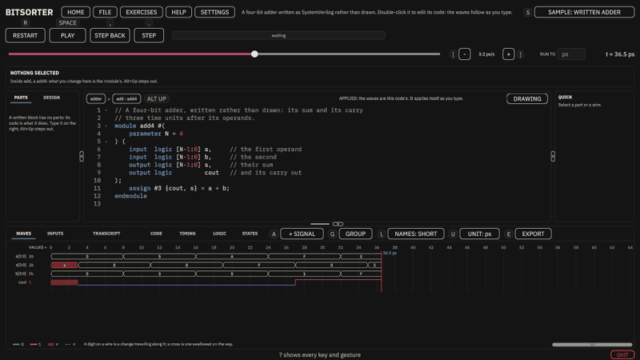
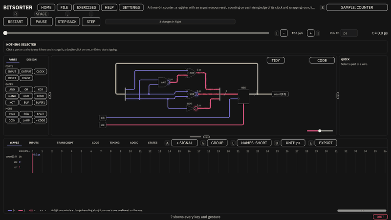
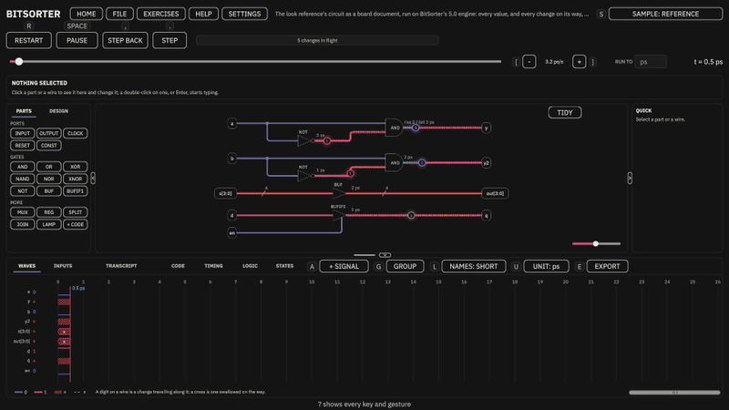

# BitSorter 5.1.0: code on every circuit, values at any zoom, a lighter Windows build

5.1 is what using 5.0.0 for the course's work turned up: sixteen fixes and additions, each asked for after a day with
the simulator. You can now edit any circuit as code. The waves are readable without zooming in. The Windows build is a
fifth smaller and leaves the graphics card alone while nothing moves. Nothing about your circuits or your save changes,
so 5.0.0's progress opens in 5.1 as it was.

It runs **in a browser**, on GitHub Pages with nothing to install, and **on Windows**, from the zip below.

---

## Code on every circuit
- **CODE, at the circuit's top right, is on every circuit**, drawn ones included. Over a drawing it shows the circuit as
  the SystemVerilog it makes, ready to type into, and changes nothing until what you type applies; **DRAWING** goes
  back. A new circuit shows a starter module, so NEW CIRCUIT, then CODE, is a circuit written from scratch, and an
  imported project made only of gates can be edited as code too. `Ctrl`+`Z` draws it again.
- An Exercise is answered in code the same way, through CODE: WRITE IT and DRAW IT are gone.
- **Code is coloured as SystemVerilog on Windows too**, as it already was in the browser: keywords, numbers and strings,
  comments, and system tasks and operators, each in a colour of the look in use and readable on its background.
- **Code folds.** A **-** in the margin folds a module, a `begin … end`, a port list or a comment to one line, and **+**
  opens it; `Ctrl`+`Shift`+`[` and `]` do the same where the caret is. The margin keeps the code's own line numbers,
  standing in one column.

## Waves you can read
- **A bus's value reads without zooming in.** A box too narrow for the whole value drops its leading zeros first, so an
  address reads `6C` rather than `0000006C`, and then shows as much as fits with `…`; before, it showed nothing.
- **Point at a box** for a tip with the whole value, the signal's width and the time it holds.
- **VALUES +**, at the head of the values beside the names, or `W`, widens that column to show every value whole;
  **VALUES -** cuts them again.
- **Drag a row by its name** to move it, up or down. A line shows where it will go, and `Esc` puts it back. The order
  you make survives edits of the circuit.
- **The RISC-V processors open on the signals that show them working:**
  - the single-cycle processor on the textbook's eight: PC, instruction, ALU result, write data, memory write, read
    data, register write and the value written back;
  - the multicycle processor on its state and instruction register;
  - the pipelined processor on its stall, its flush and its stages' own signals.

  They opened on `clk` and `rst` alone.
- **A click on the waves never changes an input.** INPUTS sets them; a double-click on an input's wave once flipped it.
- The radix menu says **UNSIGNED DECIMAL** and **SIGNED DECIMAL** in full.

## Files and the window
- **Import from any folder on Windows.** FILE, IMPORT A PROJECT'S FOLDER or IMPORT A PROJECT'S FILES opens Windows' own
  picker wherever you left it last.
- **QUIT**, at the window's bottom right, closes BitSorter even in fullscreen. It asks first, and keeps everything,
  code you typed and did not apply included.

## Samples
- **"Is it prime?" works out primality for any width:** set `N` in its testbench. It answered 0 for every number from
  16 up when its input was widened. At four bits LOGIC still gives its truth table, K-map and smallest sum of products.
- **Fixed:** a written testbench edited in the code ran to where its old text stopped, cutting a longer run short or
  running a shorter one past its own `$stop`. Applying the code now measures the run again.

## Lighter and quieter
- **The Windows build spares the graphics card while nothing moves.** A second after anything last moved it runs twenty
  frames a second and draws one in four, and your own vertical sync and frame cap come back the moment you move the
  mouse or press a key. On a laptop whose screen hangs off its other graphics chip, every frame is copied across, drawn
  or not. Measured on one, sitting still:

  | | CPU | GPU 3D | GPU copy |
  |---|---|---|---|
  | 5.0.0 | 1–3% | ~6% | 20–30% |
  | 5.1.0 | 0.2% | ~2% | ~5% |

  (5.0.0 drew every frame at the screen's rate whatever happened, at about 56% of the GPU in Task Manager.)
- **The Windows build ships only the code it runs:** 79.5 MB in 127 files, from 99.3 MB in 190, and 30.1 MB zipped
  from 38.2.
- **A return visit to the browser build downloads under a kilobyte** of its 7.5 MB of code, which the browser now keeps
  between visits. At 10 Mbit/s a return visit went from 8.7 seconds to about 3.

---

## How it is checked
- **About 4,380 automated tests:**
  - 3,940 run under `dotnet`: the language, the engine, the document, the workbench's logic, and the repository's own
    rules;
  - 182 in Unity's Edit Mode;
  - 258 in Play Mode, which drive the real workbench with a scripted mouse and keyboard.
- **The engine is held to Icarus Verilog** on every corpus testbench in CI, signal by signal, and to **ModelSim** on
  the release machine before release. Where the standard and a simulator disagree, the standard wins, and the
  difference is written down.
- **56 reference screenshots**, compared to the pixel, every change to them looked at.
- **Measured before it was built:** the idle frame loop and the browser's caching were each measured on the release
  machine first, and kept because the numbers moved.

## Downloads
| | Size |
|---|---|
| In a browser (GitHub Pages) | 11.2 MB on a first visit, as 5.0.0's 11.1; a return visit downloads under a kilobyte while nothing has changed |
| Windows (the zip below) | 30.1 MB zipped, 79.5 MB unzipped; unzip it and run `BitSorter/BitSorter.exe` |

Nothing about your circuits is ever sent anywhere. The one thing BitSorter reports is which Exercise is opened and
which is solved, so the hardest ones can be found. **Settings, PRIVACY** turns that off.

## Thanks
To everyone who tested it, and to every student of Digital Systems and Computer Structure.
