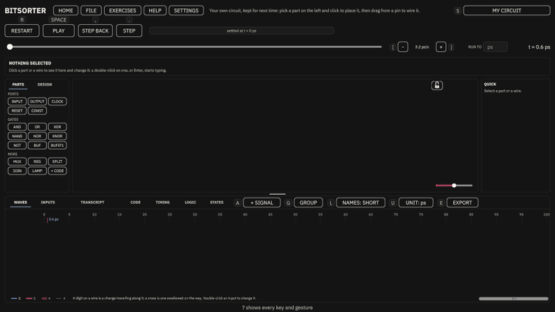
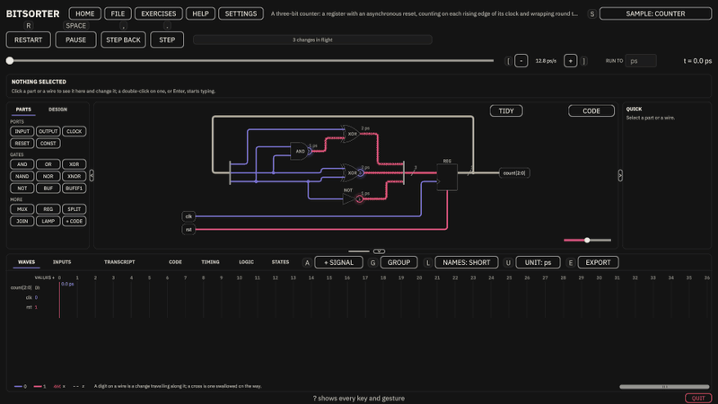
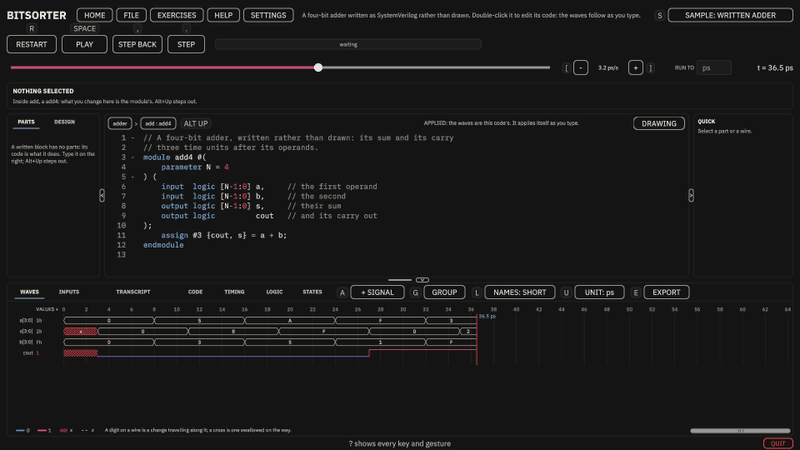
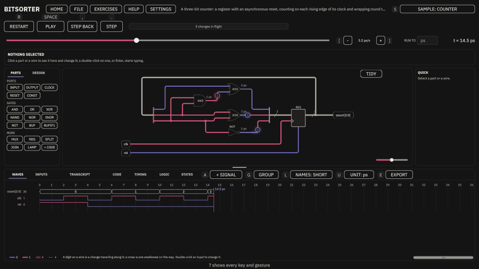
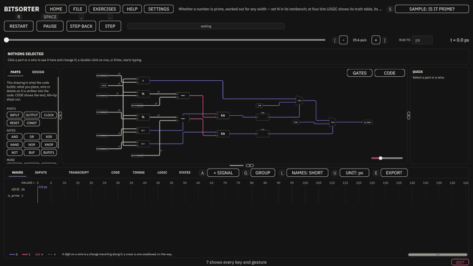
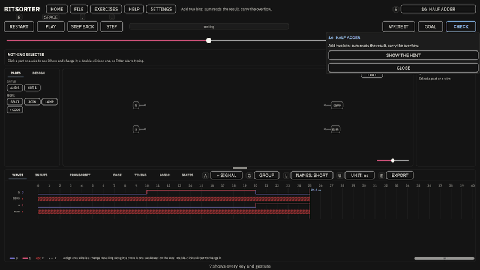
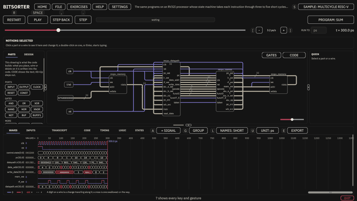
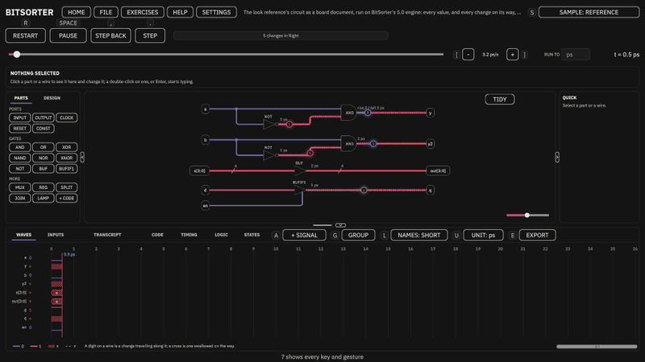

# BitSorter

[](https://github.com/AdzAhm/BitSorter/actions/workflows/tests.yml)

A SystemVerilog simulator for the Digital Systems and Computer Structure course.

Draw a circuit from gates, or write it in SystemVerilog, and run it on a 4-state,
event-driven engine with real gate delays. Read every signal on the waves, find the
critical path, see the truth table and the state diagram the circuit makes, check
your work against thirty-five Exercises, and take a project in from ModelSim and
back out again. It runs in a browser and on Windows.



Version 5.0.0.

## Where to run it

| Version | Where |
| --- | --- |
| **BitSorter 5.0, in a browser** | [GitHub Pages](https://adzahm.github.io/BitSorter/). Nothing to install, no account. |
| **BitSorter 5.0, on Windows** | [The latest release](https://github.com/AdzAhm/BitSorter/releases/latest), a zip. |
| **BitSorter 4.0.0**, the puzzle game this began as | [Unity Play](https://play.unity.com/en/games/c22f4580-98a3-4fcd-a844-e9d731257c83/bitsorter). Its source is the `v4.0.0` tag. |

BitSorter began as a puzzle game in which bits fell through logic gates into bins.
5.0 rebuilt it as a simulator for the course. The game's thirty levels live on as the
first thirty Exercises, and 4.0.0 is still played where it was released. It is not
part of 5.0. On Windows, and at the GitHub Pages address 4.0.0 was first released at,
the two share one save, and 5.0 carries over what the names still mean -- the levels
solved, as Exercises solved, and the hints seen -- but not 4.x's boards, free-play
circuits or blocks: the first time 5.0 saves, they are left out of the file. To go back
to 4.0.0 with them, keep a copy of `progress.json` first ("Your progress", below, says
where it is).

**Want to help?** Bug reports, exercise ideas and code are all welcome.
[CONTRIBUTING.md](CONTRIBUTING.md) explains how to open an issue, fork the project
and send a pull request.

---

## What it does

- **Draw.** Gates with their own rise and fall delays, muxes, registers, constants,
  splitters and joiners, tri-state buffers and buses. Wire from any pin, turn and
  mirror parts, align and copy them, and undo anything. Make a selection a block,
  step inside it with a double-click, and place it as an array of copies.
- **Write.** SystemVerilog modules with `always_ff` and `always_comb`, `generate`,
  functions, tasks and interfaces, checked as you type with each error marked on its
  line. Drawn and written modules work together in one design.
- **Run.** Each change travels its wire at the speed you choose. Play, pause, step
  from edge to edge or back, run to a moment, or break when a signal takes a value.
- **Read the waves.** Binary, hex, or unsigned or signed decimal; two cursors and
  the time between them; groups of signals; export to VCD or PNG.
- **Analyse.** TIMING finds the critical path and the minimum clock period. LOGIC
  gives the truth table, minimal expressions and K-maps. STATES draws the state
  diagram.
- **Practise.** Thirty-five Exercises, from routing a single bit to pipelining, each
  with a goal, a hint if you want one, and CHECK.
- **Bring your own project.** Import its files with their testbench and memory images,
  run it with every `$display` in the TRANSCRIPT, export it as a project ModelSim runs,
  and hold BitSorter's run to ModelSim's.
- **Run a processor.** An RV32I single-cycle, multicycle and pipelined RISC-V, each
  running three small programs.

---

## Using it

**In a browser,** use the link above. What you build is saved by the browser itself,
so it survives a reload but is per browser and per device; a private window, or
blocked site storage, makes BitSorter forget between sessions. In the browser's
fullscreen the first `Esc` leaves fullscreen, because the browser keeps that key for
itself. The same simulator runs faster as the desktop build, which a drawing of hundreds
of parts notices; the browser says so, once, if it is ever slow to draw yours again.

**On Windows,** unzip the release anywhere and run `BitSorter.exe`. Nothing is
installed and nothing is written outside your own user folder. Windows will probably
warn that it does not recognise the publisher: the build is unsigned, which is all
that warning means. "More info", then "Run anyway". There is no build for macOS or
Linux; use the browser version.

The version you are running is at the foot of the start page, and in the credits. It is
worth including if you report a bug.

### The start page

BitSorter opens on whatever you had open last, a circuit of yours, an Exercise or a
sample, and with nothing on its **start page**: NEW CIRCUIT, OPEN A CIRCUIT and IMPORT
A PROJECT; the TUTORIAL, the keyboard map and SETTINGS; your RECENT circuits; the
SAMPLES; the EXERCISES; and the RISC-V PROCESSORS. **HOME** goes back to it.

The header has the app's menus: HOME, FILE, EXERCISES, HELP (the keyboard map, the
start page, the tutorial, and ABOUT BITSORTER) and SETTINGS. There is no BACK; `Esc`
closes whatever is on top, one thing a press, and never leaves the workbench. `?` lists
every key and gesture.

The samples are a reference circuit, a full adder, a counter, four half adders, an
adder written as code, a traffic light, a two-bit ALU, a test for a prime, a sequence
detector and a seven segment decoder. `S` steps through them, and on through the three
RISC-V processors.

adder written as code, a traffic light, a two-bit ALU, a check of whether a 4-bit
number is prime (the one to open LOGIC on: its truth table, its K-map and its smallest
sum of products), a sequence detector and a seven segment decoder. `S` steps through
them, and on through the three RISC-V processors.

### Drawing a circuit

Pick a part in PARTS and click to place it; `Esc` puts a part in hand down.
Every pin nothing is wired to has a short lead ending in an open circle: point at one
and it lights, and a drag from there draws a wire. While you draw one, the pins it can
end on show their circles. Double-click a part or a wire, or press `Enter` with one
selected, to edit it in the inspector: its delays, its width, its name.

| Action | Effect |
| --- | --- |
| Left drag | Move the selection, or draw a box round parts |
| Middle drag, or `Space` and a drag | Pan |
| Wheel | Zoom; `F` fits the whole circuit |
| `Alt` while dragging or placing | Place freely, off the grid |
| `Q`, `Shift`+`Q`, `V` | Turn a quarter, turn back, mirror |
| `Ctrl`+`C`, `X`, `V` | Copy, cut, paste |
| `Ctrl`+`Z`, `Ctrl`+`Y` | Undo, redo; a drag is one step |
| Right-click | The canvas's menu: align, spread, turn, mirror, route again, reset size, tidy, copy, cut, paste, make block, delete |
| Drag the handles on a selected block | Resize it |
| Double-click a block, `Alt`+`Up` | Step inside it, step back out |

Every edit is checked by building the document it would make: one that adds an error is
refused with that error.



### Reading the waves

A click on the waves puts a cursor there and a drag moves it through the run; the values
beside the rows are the ones at the cursor. `Shift` and a click moves the playhead, the
moment the circuit shows. The time between the two is written under the rows. The wheel
zooms, and a range bar at the legend row's right end shows how much of the run is on
screen. Double-click an input's wave to set it.

**INPUTS,** beside WAVES, gives the inputs as a table you type in: a column per input,
a bus one column in binary, hex or decimal, and a row per moment something changes.
Choose columns by their names, then **ALL COMBINATIONS** fills in every combination of
them, **COUNT** counts a bus up and **CLOCK** makes one a clock; **+ ROW**, **STEP** and
**END** do the rest, and `Ctrl`+`Z` takes any of it back. A design imported with its
testbench shows what the testbench applies, read only, with **CONVERT** beside it to turn
that into rows you can edit.

**TRANSCRIPT** holds the run's messages, `$display` included, and each warning and error
with its file and line.



### Writing SystemVerilog

`+ CODE` in PARTS makes a block you write rather than draw, and a double-click on one
opens its code in the circuit's window. It applies itself when you pause typing;
**Ctrl+Enter** or **Ctrl+S** applies it at once. Code with an error stays as you typed it,
marked NOT APPLIED while the waves are the last code that worked, and it is kept: step
out, open another circuit or a sample, or quit, and it is there when you come back, until
you fix it or press **REVERT**. (A browser runs nothing as its tab closes, so there what
you typed in the last two seconds before closing it may not be kept.) **Ctrl+Z** and
**Ctrl+Y** undo and redo the typing, **Tab** and **Shift+Tab** indent and outdent by four
spaces, and **Ctrl+/** comments lines out or back in. In a browser **Ctrl+F** finds and replaces and **Ctrl+D**
selects the next match. While you type, none of the workbench's own keys act.

The classic first slips are answered with what to write instead: an `assign` inside an
`always`, `logic s[1:0]` used as a bus, an `if`, `for` or `case` on a signal outside an
`always`, an instance with no name, `always_comb @(...)`. Curly quotes, dashes and
no-break spaces pasted from a slide are read as `'`, `"`, `-` and a space, with a warning,
and exported that way, so ModelSim takes what ran here.

The **CODE** tab in the dock prints a drawn circuit as the SystemVerilog it makes, read
only. The lines that the selected parts come from are marked and scrolled into view, and a
click on a line selects the parts it makes.

### The drawing of code

A written module is shown as the drawing of its code, or as its code. It opens as its
drawing, laid out in columns from the netlist the code builds; CODE and DRAWING, in the
code's top strip, turn between the two. Every part of the drawing comes from a line of the code,
which the inspector names, and says first what the code's comment on that line says.

- **GATES** opens every operator and mux of four bits or fewer, and a sum or a difference of
  4-bit numbers, into their gates; BOXES closes them. In a browser GATES opens no more than
  800 parts and says the desktop version opens them all.
- **A controller is drawn as the textbook draws one.** A state machine written in code,
  a register with a `case` on it, is shown as its state diagram, each state a box of what
  it sets and every arrow labelled in the code's own words; a decoder, a `case` that sets
  outputs, as its control table. The state the run is in is lit as it plays. DIAGRAM, TABLE
  and DRAWING turn between the views, and every reading is held to the engine before it
  is shown.
- **Unlocked, the drawing takes edits,** written back into the code. A part moved or turned
  by hand is kept with the module and the code left alone; TIDY lays it out again.
- **The padlock** in the circuit window's top strip locks a circuit against edits. An
  imported project opens locked, except a course template; a sample and an Exercise never
  lock. FILE, BACK TO AS IMPORTED puts an import back as it came in.



### The course's tools

Once a circuit works, the workbench answers the questions the course asks of it.

- **TIMING** lists every path from an input to an output, worked out by the textbook
  rule: each gate adds its Tpdlh where its output rises and its Tpdhl where it falls.
  The slowest comes first and is lit on the circuit; a click on another path lights that
  one. For a circuit with registers, give each its clock-to-Q and setup in its inspector,
  and the tab gives the minimum clock period and the frequency that allows. For a
  pipeline whose every path from an input to an output crosses the same number of
  registers, it gives the latency in clock periods and the throughput, one result each
  period; any other design is told why it has no one latency. It counts the gates too.
- **The measured worst.** For up to ten input bits and no registers, TIMING steps every
  input up and down from every value of the others and shows the slowest each output
  really changed, and the inputs that caused it. A path no step ever fires is marked "never
  fires". **STEP TEST** turns your stimulus into a step test, one input at a time.
- **LIBRARY** holds a design to a gate library. **COURSE CELLS** allows only the course's
  cells, with their delays, and PARTS then offers only those. You can take a kind of gate
  out, refuse constants, and set a gate budget the gate count is held against. Code you
  write is held to the library too: every gate one of its cells, no logic written with
  operators, a register only as an `always_ff` of plain writes.



- **LOGIC** shows what a circuit without registers does: its truth table, found by running
  the engine through every combination of its inputs (up to ten bits); for eight input
  bits or fewer each output as a minimal sum of products, the textbook's way and
  SystemVerilog's, marked where the search stopped short of proving it the smallest; and for
  four inputs or fewer each output's K-map, laid out as the course draws one.
- **STATES** draws a clocked circuit's state diagram: every state it reaches from its
  reset, found by running the engine with every input from every state, each a circle with
  an arrow for each way on, and the next-state table beside it. It says whether the machine
  is Moore or Mealy. Up to six register bits, four inputs besides the clock and reset, and
  sixteen states.
- **Warnings, as ModelSim's `vlog` gives them.** A signal read that nothing drives, one set
  that nothing reads, two drivers that cannot both let go, a value cut short by a narrower
  target. They never stop a run.
- **Races.** A process, most often a testbench, that changes a flip-flop's input with `=`
  on the very clock edge the flip-flop takes it at leaves the two in either order, and
  another simulator may not agree on which. BitSorter warns of it as the run makes it.
  Change the input on the other edge, a moment later, or with `<=`.
- **Buses.** Several tri-state gates may drive one wire; where two drive at once it reads
  x. Written code may use `inout` ports, and a block of it shows an inout pin you can
  wire onto a bus.

### Exercises

**EXERCISES** lists the thirty-five, chapter by chapter in the course's order, the ones you
have solved marked and the next one picked out. An Exercise opens with its brief: what to
build, and a hint if you ask for it (**GOAL** brings the brief back). Its own test drives
the inputs, so PARTS has no ports, and of the gates, registers and blocks only the ones the
Exercise gives, each with how many are left -- beside SPLIT, JOIN, LAMP, a constant where
it allows one, and blocks of your own. **CHECK** grades the circuit, and code as you typed
it; code with an error is not checked, and the chip says why. Each check that failed is a
line in the TRANSCRIPT that takes the run to its moment. Once it is solved, a card says how
many gates it took and how fast it settles, beside your best, and offers the next.



**WRITE IT** answers an Exercise in SystemVerilog instead: your drawing becomes code,
gate for gate, and you carry on typing. It is held to the same parts as a drawing and
graded the same way. **DRAW IT** goes back to drawing, and draws your code as its gates.
Some Exercises open on a circuit with something wrong in it, for you to find.

New to it? **TUTORIAL**, on the start page and in HELP, walks you through the first
Exercise one click at a time, and the simulator explains a few things the first time you
meet them: a gate's delay, a clock, a glitch, a z, an x.

| Chapter | Exercises |
| --- | --- |
| 1. Gates | Route the bit, Odd one out |
| 2. K-maps | Four corners, Don't care |
| 3. NAND and NOR | Nothing but NAND |
| 4. Delay and buses | The long way round, Balance the paths, The slow lane, Out of step, Share the wire |
| 5. Building blocks | One of four, Pick a lane, Four lanes, Highest wins, Which is bigger |
| 6. Adders | Half adder, Carry the one, Wrong part, Pass it on, Carry it further, Four at once, Look ahead |
| 7. Flip-flops and registers | One clock late, Start from nothing, Rising edge, Flip on one, Hold when told |
| 8. Counters and state machines | Count the ones, Miscount, Spot the pattern, One clock behind, Add as you go |
| 9. Critical path and pipelining | Find the slow path, Cut it in two, Keep in step |

### Three RISC-V processors

The start page gives the RV32I single-cycle, multicycle and pipelined processors a section
of their own, written from the RISC-V specification. Each runs any of three small
programs, the sum of 1 to 10, the first ten Fibonacci numbers, or every instruction it
runs once, checking itself, picked from the **PROGRAM** chip beside the run or straight
from the start page. Open one to read its drawing, double-click a block to step inside,
and compare how many clock cycles each takes: for the instruction test, 316, 1,204 and
346. They are there to be run and read, not taught.



### Your own SystemVerilog, in and out

The **FILE** menu keeps your circuits and takes a project's files in and gives them back.

- **Your circuits.** MY CIRCUIT is always there. NEW CIRCUIT makes another, named, and
  OPEN A CIRCUIT lists them all; RENAME and DELETE work on any but MY CIRCUIT, and DELETE
  asks first. Each is kept as you leave it, and each exports under its own name.
- **Import.** On a desktop, put a project's files, its `.sv` files, any files they
  `` `include ``, and the memory images `$readmemh` reads, in the Import folder (FILE,
  OPEN THE IMPORT FOLDER), then IMPORT. In a browser, IMPORT picks the files or a folder.
  The project opens as a circuit of its own, named after it, and nothing you already have
  is replaced. A module made only of gates is drawn; any other module is kept as the code
  you wrote. Your testbench runs as written, `$display` and all. Anything the import could
  not read is listed in the TRANSCRIPT with its file and line. An import takes up to 200
  files, 4 MB a file and 16 MB in all, and up to 200 modules.
- **Convert.** While your testbench drives the inputs, they cannot be set on the waves.
  CONVERT records what the testbench drove and makes it steps you can edit; it says first
  what it will not keep, and `Ctrl`+`Z` undoes it.
- **Export.** EXPORT PROJECT saves a zip of every file the project is, with a `run.do`:
  unzip it, and in ModelSim type `do run.do`.
- **Compare with ModelSim.** The `run.do` also has ModelSim save every signal to
  `modelsim.vcd`. Put that file in the Import folder (in a browser, pick it), and FILE,
  COMPARE WITH MODELSIM'S RUN holds BitSorter's run to ModelSim's: it says they agree, or
  takes the waves to the first moment they differ and names the signal and both values
  in the TRANSCRIPT.
- **Hand in.** Import a homework file that says `// Put your code here`, and its module
  keeps the file's markers: write your code between them. FILE, EXPORT FOR SUBMISSION then
  saves the file exactly as the course gave it, with your code between its markers. It
  refuses, and says why, if the ports, the markers or anything outside them are no longer
  the course's.



Nothing you import or export is sent anywhere: it stays on your machine, or in your
browser's tab.

### Settings and looks

**SETTINGS** has fullscreen on Windows (`Alt`+`Enter` works too), vertical sync, on by
default so the frame rate keeps to your screen's, and with it off a frame cap from 30 to
240 frames a second, or none. FPS COUNTER, on Windows and in a browser, puts a small
frame-rate counter in the top-right corner. A browser keeps fullscreen and the frame rate
to itself, so the counter is the one display switch there.

**STYLE** chooses the look: **Schematic**, the default; **Schematic Light**, the same on
paper, for a report's screenshots; **Neon Board**; and **Classic**. BitSorter loads again
to switch, and Settings is put back where you chose it. REDUCED MOTION leaves out the
glow and the gates' flashes. SHORTCUT KEYS hides the key beside each button; every key
still works. DATA is described under "What it collects", below.

BitSorter has no sound.

### Your progress

Solved Exercises, the answer you gave each, your best gate count and settle time, the
first-time hints you have seen, your circuits and what was open last save automatically.
On Windows they go to a file:

```text
%USERPROFILE%\AppData\LocalLow\ZADZ\BitSorter\progress.json
```

**To start over:** SETTINGS, then **Reset progress**. It asks first, and nothing is
forgotten unless you answer yes. A reset starts the Exercises over: every solved
Exercise, its saved answer and its best, and the first-time hints are forgotten. **Your
circuits are kept**: MY CIRCUIT and every circuit you named. Display and data settings
are not progress, so they stay as they are.

In a browser the same data lives in the browser's own storage for the address you used.
It does not travel between the desktop build and a browser.

If the file is ever damaged, say by a crash part way through saving, BitSorter starts
fresh rather than refusing to open, and keeps a copy of the damaged file beside it as
`progress.json.unreadable`.

Your progress file itself is never uploaded. Nothing is compared against anyone else
either: every number BitSorter shows is about the circuit in front of you, or the one you
built last time.

### What it collects

BitSorter uses Unity Analytics, which sends anonymous usage data to Unity.

Two events come from BitSorter itself, and nothing else does:

| Event | Sent when | Data |
| --- | --- | --- |
| `levelStarted` | The first time an exercise is opened in a session | `levelName`, the exercise's id; for the first thirty, the file name of the 4.x level they came from |
| `levelSolved` | The first time an exercise is solved in a session | `levelName`, the exercise's id; for the first thirty, the file name of the 4.x level they came from |

`levelName` is the identifier, like `half-adder` — not a display title and not
anything you typed. The pair exists to answer one question: which exercise people
stop at.

Each is sent at most once per exercise per session. Reopening an exercise, or
solving it again, is not counted a second time.

Alongside those, Unity's SDK collects its own standard session data: a random
installation identifier, session start and end, app version, platform and
operating system, device model, language, and an approximate region derived from
your IP address. That set is Unity's, not mine, and
[Unity documents it](https://docs.unity.com/analytics/en/manual/UnityAnalyticsData).

**What is never sent:** your progress file, the circuits you build, your gate counts or
timings, your personal bests, or any account, name or email. There is no
login, and BitSorter asks for nothing.

**To turn it off:** the workbench's **SETTINGS** → **Data**. It toggles between
`DATA ON` and `DATA OFF`, takes effect immediately, and is remembered on that
machine. Turning it off stops collection rather than merely hiding it — BitSorter
tells Unity's consent framework that consent is denied, and nothing is queued or
sent while it is off.

Reporting is on unless you turn it off, so if you would rather it never ran at
all, that is the first thing to change.

---

## What it teaches

The Exercises cover boolean algebra, K-map minimisation, functional completeness,
propagation delay, combinational components, adders, flip-flops, state machines, the
critical path and pipelining. Each topic is taught before an Exercise asks for it.

- **Simulated, not taught:** the course's RISC-V hardware, multicycle included, with its
  memories and `$readmemh`. The simulator has to run it; no Exercise teaches it.
- **Shown, not taught:** hazards. With gate delays a glitch is real and appears on the
  waves, but no Exercise sets out to teach static or dynamic hazards.
- **Displayed, not taught:** number representation. A signal reads in binary, hex, or
  unsigned or signed decimal.
- **Out of scope:** assembly programming and memory addressing.

Timing is a fact about your own circuit, never a ranking. Nothing compares you with
anyone else or with a par score, and that is on purpose.

---

## How it simulates

Values are 0, 1, x for unknown and z for undriven, in vectors of any width. Everything
starts as x until something drives it, and two drivers that disagree read x, which is
what ModelSim shows.

The engine is event driven: it keeps a list of "this signal changes at time T" and jumps
to the next entry, so a quiet circuit costs nothing. Changes with no delay still happen in
rounds at the same instant, delta cycles, and the rounds repeat until nothing changes.
Gates and `assign #d` are inertial, so a pulse shorter than a gate's delay is swallowed.
The delay lives on gates, as in the course, and wires are ideal.

The order drivers are visited in can never change a run: each delta cycle applies
everything due before any driver is evaluated, and a test shuffles the order. Processes are
the one place the language allows a race, so they run in a fixed order, as ModelSim
starts them, with Icarus Verilog's way one setting away. Where that order decides a value,
the run says so.

Every construct has a test, and a comparison against **Icarus Verilog** wherever it can
run. **ModelSim** is the second oracle, used wherever it is installed. Where one
disagrees with the language standard, the standard wins and the difference is written
down in [Docs/oracle-notes.md](Docs/oracle-notes.md).

---

## Developing

Unity 6.3 LTS (6000.3.11f1). [Docs/architecture-5.md](Docs/architecture-5.md) is the
architecture, the data model and the parts, and [CLAUDE.md](CLAUDE.md) holds the rules
and the reasons for them.

- **BitSorter → Build Windows Player** writes a player to `Build/Windows/`.
- **BitSorter → Build WebGL Player** writes a browser build to `Build/WebGL/`. See
  [Docs/distribution.md](Docs/distribution.md) for what differs in a browser and what
  each place that hosts a build needs.
- **BitSorter → Publish WebGL to GitHub Pages** force-pushes `Build/WebGL/` to the
  `gh-pages` branch, via [Tools/publish-pages.ps1](Tools/publish-pages.ps1). The script
  runs standalone too, and warns if the build is older than the scripts.
- **BitSorter → Generate App Icon** redraws `Assets/Icon/BitSorterIcon.png` and assigns it
  to every standalone icon size.
- **BitSorter → Build Play Scene** regenerates the scene from code. The scene is
  generated rather than authored, so anything added by hand is discarded the next time
  that runs.
- **Tests that need no Unity:** `dotnet test Tools/ci/BitSorter.Ci.slnx`. It builds the four
  pure layers against netstandard2.1, Unity's profile, runs their tests and the
  repository's rules, and runs the oracle designs under Icarus Verilog, which it skips
  when Icarus is not installed. CI runs the same on every push, with Icarus installed and
  a skip made a failure.
- **Tests in the editor:** Window → General → Test Runner, or **BitSorter → Run Tests**.
  Edit Mode has no scene. Play Mode loads the real scene on a scratch save that never
  touches yours, and does not need the window focused. Use the PlayMode tab, not the
  Player tab, which builds a whole player first.
- **BitSorter → Capture Reference Shots** screenshots the simulator in dozens of states,
  every look included. Two captures of the same code are identical to the pixel, so a
  change that claims to leave the look alone can be held to it. It needs the Game view.
- To compile without the editor at all, Bee leaves the exact compiler invocation in
  `Library/Bee/artifacts/*/BitSorter.*.rsp`; redirect `-out` and run it through
  `Editor/Data/DotNetSdkRoslyn/csc.dll`. Gate on csc's exit code rather than grepping for
  `error`, and append any source file added since Bee wrote the response file, or it is
  not compiled.

### Architecture

```text
Assets/Scripts/SystemVerilog/   the language: values, lexer, preprocessor, parser, printer
Assets/Scripts/Sim/             the 4-state event-driven engine
Assets/Scripts/Board/           the document: circuits, exercises, import and export
Assets/Scripts/ViewModel/       the workbench's layout, routes and gestures
Assets/Scripts/View/            Unity rendering, input and interface
Assets/Resources/Exercises/     one JSON file per Exercise
Assets/Tests/EditMode/          NUnit tests, no scene
Assets/Tests/PlayMode/          tests against the real scene, on a scratch save
Tools/ci/                       the pure layers built and tested without Unity, and the oracle
```

The four pure layers are assemblies with `noEngineReferences: true`, so a stray
`using UnityEngine;` fails to compile rather than silently coupling them to the engine,
and `Tools/ci` builds and tests them without Unity. They point one way, SystemVerilog
<- Sim <- Board <- ViewModel <- View, and the view changes the document and the engine
only through their commands.

The interface is built in code: the drawings are uGUI on one canvas, and the shell round
them is UI Toolkit. Sprites are generated at runtime, so there are no art files, and
BitSorter has no sound and no audio files.

---

## Contributing

Bug reports, Exercise ideas and code are all welcome. [CONTRIBUTING.md](CONTRIBUTING.md)
covers opening an issue (there are forms for bugs, features and Exercise ideas), what each
label means, the Exercise file format, setting up the project, the rules the code keeps,
tests, and forking the repository and sending a pull request.

---

## Licence

MIT: see [LICENSE](LICENSE). That covers the code, the Exercises and the docs.

The TextMesh Pro files Unity bundles under `Assets/TextMesh Pro/` keep their own
terms: the Unity Companion License, the SIL Open Font License for Liberation Sans,
and EmojiOne's for its sprites. The details are in `LICENSE`.

BitSorter's font is **IBM Plex Sans**, © IBM Corp., from
[github.com/IBM/plex](https://github.com/IBM/plex), under the
[SIL Open Font License 1.1](Assets/Fonts/IBMPlexSans/LICENSE.txt), which travels
with it in `Assets/Fonts/IBMPlexSans/`. Liberation Sans stays on as the fallback for
any character Plex does not have. Code is set in **IBM Plex Mono**, from the same
family and under the [same licence](Assets/Fonts/IBMPlexMono/LICENSE.txt), in
`Assets/Fonts/IBMPlexMono/`. Both are named in the credits, as is Icarus
Verilog, the simulator BitSorter's engine is checked against.

The browser build's code editor is **[CodeMirror](https://codemirror.net)** 6,
© Marijn Haverbeke and others, under the MIT licence: bundled into
`Assets/Plugins/WebGL/codemirror.jspre` by `Tools/codemirror/build.ps1` from the
versions `Tools/codemirror/package-lock.json` pins, and never fetched while BitSorter
runs. The file's head names every package in it, its version and its copyright.
